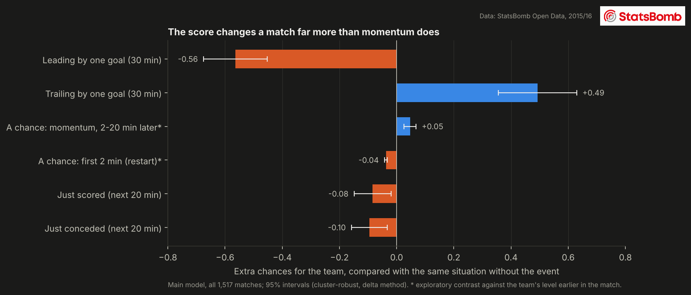
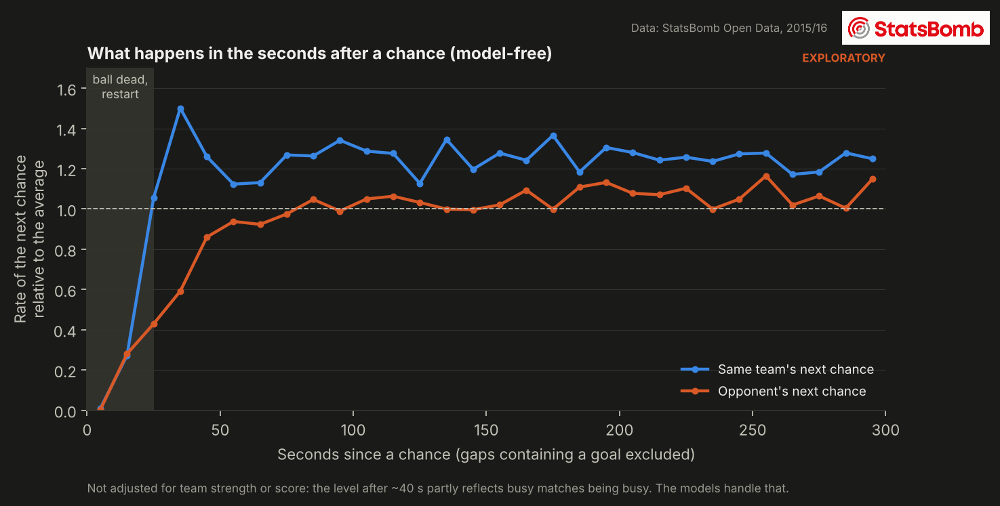
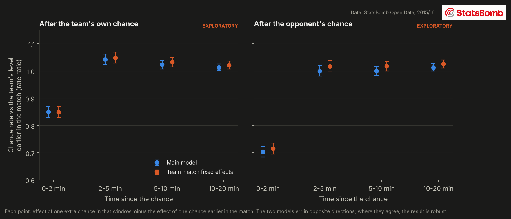
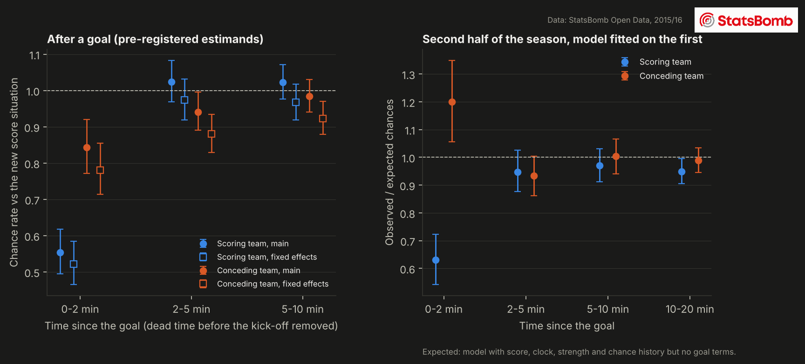
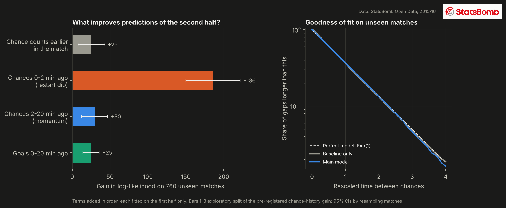
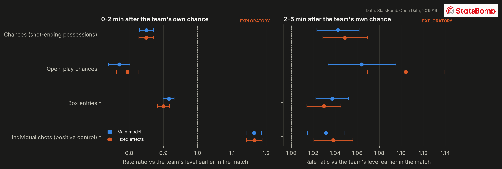

# Is momentum real? Almost not. The score is.

**Does a chance lead to more chances? Is a team "most vulnerable just after it has scored"?** A self-exciting
point-process model of when teams create chances, fitted on every match of the 2015/16 Premier League, La Liga,
Serie A and Ligue 1 (StatsBomb event data, 1,517 matches, 34,991 chances), with a design written down before the
timing of chances was analysed, out-of-sample validation on the second half of the season, and models that err in opposite
directions so that a result counts only if both agree.

<p><br><sub>Data: StatsBomb Open Data</sub></p>

**[Open the match explorer](https://ridhimagupta4.github.io/is-momentum-real/)**: build a match on a 90-minute
timeline (click to add chances and goals for either side), watch both teams' expected chance rates respond, and see
for that match how many expected chances come from the score, the team's level that day, restarts and momentum,
each with a 95% interval (delta method with the model's cluster-robust covariance). Illustrative scenarios and
shareable links included. Every number on the page, intervals included, is computed from the fitted coefficients and
tested against an independent Python computation.

---

## Key results



| | |
|---|---|
| **The score matters far more than momentum** | Trailing by one goal: **+0.49 extra chances over 30 minutes** (95% CI 0.36 to 0.63); leading by one: −0.56 (−0.67 to −0.45). |
| **Momentum exists, but it is tiny** | A chance is followed by **+0.047 extra chances** for the same team over the next 2–20 minutes (0.026 to 0.068), compared with the same chance earlier in the match. That is about one extra chance for every 21 chances. *Exploratory (see below).* |
| **No momentum after scoring** | In 2–5 and 5–10 minutes after scoring, the scorer's chance rate is unchanged: rate ratio 1.024 (0.969 to 1.083) and 1.023 (0.977 to 1.072). |
| **Not "most vulnerable just after scoring"** (measured in chances) | The conceding team does **not** create more chances: 0.843 (0.772 to 0.920) in the first 2 minutes after the restart, 0.941 (0.890 to 0.995) in 2–5 minutes, 0.984 (0.940 to 1.030) in 5–10. An increase of more than about 3% is ruled out in every window. |
| **The first two minutes after a chance are quiet** | Both teams create fewer chances: rate ratio 0.850 for the same team and 0.703 for the opponent. Mostly restarts (goal kicks, corners, the keeper holding the ball) and the definition of a chance, not football psychology. |
| **Out of sample** (fitted on the first half of the season, scored on the 760 matches of the second) | Chance history improves predictions by 240 log-likelihood units (95% CI 195 to 286), goal terms by a further 25 (14 to 36). Split of the chance-history gain (exploratory): 25 from counts earlier in the match, 186 from the two-minute restart dip and only 30 (12 to 47) from the momentum windows. |

---

## Why this question

Commentators, coaches and players talk about momentum constantly, and "a team is most vulnerable just after it has
scored" is close to football folklore. If momentum were real and large, it would matter for in-game decisions
(when to change shape, when to make a substitution) and for live betting markets. It is also a hard statistical
question: the obvious analyses are biased in ways that can manufacture momentum where there is none, or hide it
where there is some.

## Data

- [StatsBomb Open Data](https://github.com/statsbomb/open-data), pinned to commit
  `4b73468fc5b0f1950f9f66fada70ad3a4f9327cb`; all 3,040 downloaded files are checked against their git blob hashes
  (`data_manifest.tsv`; the line-up files are downloaded too but not used in this project).
- 2015/16 Premier League, La Liga, Serie A (380 matches each) and Ligue 1 (377; three are not in the release):
  1,517 matches, 3,997 goals. Bundesliga 2015/16 excluded (only one team's matches are released).
- **Chance:** a possession in which a team shoots at least once, timed at its first shot (34,991 chances). One
  attack with a rebound is one chance.
- Sensitivity event types: open-play chances (21,938), box entries (43,455), and individual shots (37,888) as a
  positive control.

## Method

The intensity of chances for a team at time t is modelled as

```
log rate(t) = baseline(t) + sum over windows w of gamma_w * (number of events in window w before t)
```

- **Baseline:** clock (15-minute bins in each half), score (down 2+, down 1, level, up 1, up 2+), players on the
  pitch, home, and pre-match strength (each team's chances created and the opponent's chances conceded per 90 in
  matches played *strictly before* this one, shrunk towards the league average).
- **History:** the team's own and the opponent's chances 0–2, 2–5, 5–10 and 10–20 minutes earlier in the same half;
  their chances earlier in the match (which absorb a team simply having a good day); goals scored and conceded in
  the same windows.
- **Dead time after goals is removed:** from the goal to the following kick-off (median 56 seconds) no chance is
  possible, and counting that time would manufacture a post-goal dip.
- Because every covariate is constant between change points, the likelihood is exactly a Poisson regression on
  time segments with log-duration offsets. No numerical integration and no simulation is involved. The solver is
  checked against `statsmodels` in the tests (coefficients agree to 1e-9; the fixed-effects version against an
  explicit dummy-variable fit).
- **Uncertainty:** cluster-robust standard errors with matches as clusters; Holm correction over the eight
  pre-registered tests. Clustering by team, or two-way by team and opponent, changes the standard errors of the
  eight primary estimates by at most 12% and no conclusion (`results/explore_clustering.csv`).

### Three models that err in opposite directions

| Model | Heterogeneity control | Known bias on history effects |
|---|---|---|
| No-heterogeneity | pre-match strength only | **upwards**: busy matches look like momentum |
| **Main** | pre-match strength + chances earlier in the match | small |
| Fixed effects | a separate intercept for every team in every match (exact conditional likelihood) | **downwards**: with about ten chances per team-match, the dynamic-panel (Nickell) bias |

A result is called robust only if it holds in both the main and the fixed-effects model. The no-heterogeneity model
turned out to give goal estimates within 0.007 of the main model's (for example 0.948 against 0.941 for the conceding
team at 2–5 minutes), so for the goal results the earlier-in-match counts matter little.

### Leakage and validity controls

| Risk | Control | Checked by |
|---|---|---|
| Intensity using information from the moment being predicted or later | Covariates evaluated strictly before each event (left-continuous intensity) | Test: covariates of 400 random chances recomputed from raw events |
| Team strength learned from the matches being modelled | Strength from matches on strictly earlier dates only | Test: changing all later outcomes leaves strengths unchanged |
| Validation on data the model saw | Fitted on first halves of the season, scored on second halves | Separate fits; test that the halves are ordered in time |
| Dead time after goals faking a post-goal dip | Removed from exposure, using the kick-off events | Test: no event falls inside dead time |
| Goals credited to the wrong team | Teams matched by id, never by name | Test: goals per team equal the official score in all 1,517 matches |
| Choosing analyses after seeing results | Design written first (`DESIGN.md`); every later change listed there; exploratory results labelled everywhere | `DESIGN.md` |

## Results

### 1. The seconds after a chance



Within 10 seconds of a chance, another chance (by either team) is almost impossible: 0.006 times the average rate.
The rate recovers over the next 20–30 seconds as the ball comes back into play. This is what the pre-registered
"two minutes after a chance" estimate mostly measures. It is real, but it is about restarts and the way a chance is
defined, not momentum: counted as individual shots, so that rebounds count, the same window shows a rise
(rate ratio 1.165 relative to the earlier-in-match level).

### 2. Momentum: small, consistent, short-lived *(exploratory)*



After the restart dip, a team's chance rate is slightly higher for a few minutes than its level earlier in the
match: rate ratio 1.042 (1.023 to 1.062) at 2–5 minutes, 1.023 at 5–10 and 1.013 at 10–20 in the main model. The
fixed-effects model, biased in the opposite direction, gives 1.049, 1.033 and 1.022, so the effect is not an
artefact of how heterogeneity is handled. The opponent's rate is unaffected after the first two minutes
(1.000 at 2–5 minutes). The effect holds for open-play chances only (1.064 at 2–5 minutes), so it is not corners
after deflected shots.

This analysis was not pre-registered. It was added after the pre-registered 0–2 minute estimate turned out to be
dominated by restarts, and it is reported as exploratory, with nominal 95% intervals that are not corrected for the
number of exploratory comparisons.

### 3. After a goal



The pre-registered goal estimands, relative to the new score situation:

| | 0–2 min | 2–5 min | 5–10 min |
|---|---|---|---|
| Scoring team, main model | 0.553 (0.495–0.618) | 1.024 (0.969–1.083) | 1.023 (0.977–1.072) |
| Scoring team, fixed effects | 0.522 | 0.973 | 0.967 |
| Conceding team, main model | 0.843 (0.772–0.920) | 0.941 (0.890–0.995) | 0.984 (0.940–1.030) |
| Conceding team, fixed effects | 0.781 | 0.880 | 0.923 |

Holm-adjusted p-values (main model): 0–2 minutes < 0.001 for both teams; all later windows ≥ 0.135. Right after the
restart, the scoring team creates far fewer chances (the opponent has the ball from the kick-off), and so does the
conceding team. After that, nothing that would count as momentum, in either direction.

On the second half of the season, with a model fitted on the first half that knows about chances but not goals,
the conceding team got more chances in the first two minutes than that model expected (observed / expected 1.20,
1.06 to 1.35). That is because the conceding side restarts with the ball: its dip is smaller than after an
ordinary opponent chance. It is still a dip compared with its normal rate (0.843 above).

### 4. Does any of this predict unseen matches?



Fitted on first halves of the season and scored on the 760 second-half matches: chance history improves the
log-likelihood by 240 (195 to 286) and goal terms by a further 25 (14 to 36). Splitting the chance-history gain
(exploratory): 25 from the earlier-in-match counts, 186 from the restart dip, 30 (12 to 47) from the momentum
windows. Goodness of fit by the time-rescaling theorem: the distribution of rescaled gaps between chances is close
to the Exp(1) a perfect model would give (largest difference 0.029 for the main model, 0.036 for the baseline), but
with 17,464 events the exact conditional test still detects a small misfit (KS 0.0155, p = 0.0004). The model is
good, not perfect.

### 5. Robustness



Every event definition shows the same pattern: a dip right after a possession-level event and a small excess at
2–5 minutes. The individual-shot positive control shows the opposite sign in the first two minutes (rebounds), so
the method does detect short-term clustering when it exists. By league (`results/estimands.csv`): the two-minute dips
after a chance and the scoring team's two-minute dip are significant in all four leagues; the conceding team's
two-minute dip points the same way everywhere but is not significant in Ligue 1 (0.932, 0.791 to 1.098) or Serie A
(0.902, 0.760 to 1.070).

## What this does not show

- **The momentum contrasts are exploratory.** They were chosen after the pre-registered short-window estimate
  turned out to measure restarts. They are consistent across models, event types and the out-of-sample test, but
  they were not fixed in advance.
- **The score effect is not causal proof of tactics.** Trailing teams create more chances and leading teams fewer,
  conditional on strength and the clock, but the model does not say why (pressing, risk-taking, the leader sitting
  deep).
- **Chances, not quality, and not goals.** A chance is any shot-ending possession; xG-weighted analyses could differ.
  "Most vulnerable after scoring" is tested here through the chances the conceding team creates, not the goals it
  scores: with 3,997 goals in the data, a goal-level test would be far less precise.
- **One season, four leagues, 2015/16.** The method transfers; the numbers may not.
- **Timing within windows.** History is counted in windows (0–2, 2–5, 5–10, 10–20 minutes), and the goodness-of-fit
  test detects some remaining misfit, probably within those windows.
- **Interruptions other than goals** (injuries, substitutions) are not removed from the time at risk. VAR did not
  yet exist in these leagues in 2015/16.

## Reproduce

Requires Python 3.13, about 5 GB of disk and 8 GB of RAM; about 10 minutes on two CPU cores.

```bash
pip install -r requirements.txt
./fetch_data.sh          # downloads the pinned StatsBomb files and verifies every hash (~4.3 GB)
./run_all.sh             # events -> segments -> models -> figures -> page -> tests
```

All results are deterministic (fixed seeds for the resampling intervals).

## Repository layout

```
DESIGN.md              design written before the analysis, deviations, and the exploratory analyses added later
src/build_events.py    chances, goals, kick-offs, dead time, players on the pitch (teams by id)
src/segments.py        time segments with constant covariates; pre-match strength from earlier dates only
src/model.py           exact piecewise-exponential likelihood; fixed effects by conditional likelihood; sandwich SEs
src/analysis.py        pre-registered analyses: estimands, out-of-sample test, goodness of fit, after-goal check
src/exploratory.py     exploratory: momentum contrasts, out-of-sample split, seconds after a chance
src/summaries.py       effects in extra chances (delta-method intervals)
src/figures.py         all figures
explorer/              interactive page (coefficients only), built into docs/index.html
results/               every table behind the numbers in this README
tests/                 leakage, data-integrity and README-number tests
```

## Licence and credit

- Code: MIT licence (`LICENSE`).
- Data: StatsBomb Open Data, used under the StatsBomb Public Data User Agreement. No StatsBomb data are included in
  this repository. The results, figures and interactive page are derived analysis shared for non-commercial use and
  are not covered by the MIT licence. StatsBomb logo shown as the data credit. See `THIRD_PARTY_NOTICES.md`.

## References

- Hawkes, A. G. (1971). Spectra of some self-exciting and mutually exciting point processes. *Biometrika* 58(1).
- Brown, E. N., Barbieri, R., Ventura, V., Kass, R. E. and Frank, L. M. (2002). The time-rescaling theorem and its
  application to neural spike train data analysis. *Neural Computation* 14(2).
- Nickell, S. (1981). Biases in dynamic models with fixed effects. *Econometrica* 49(6).
- Holm, S. (1979). A simple sequentially rejective multiple test procedure. *Scandinavian Journal of Statistics* 6(2).
